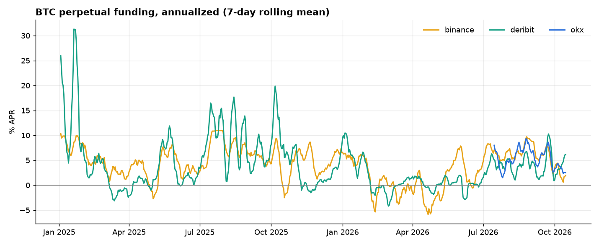
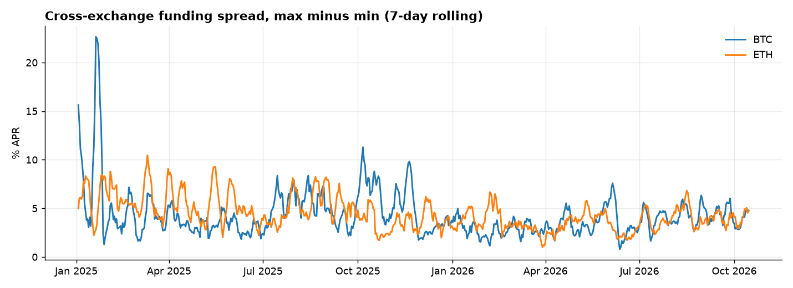
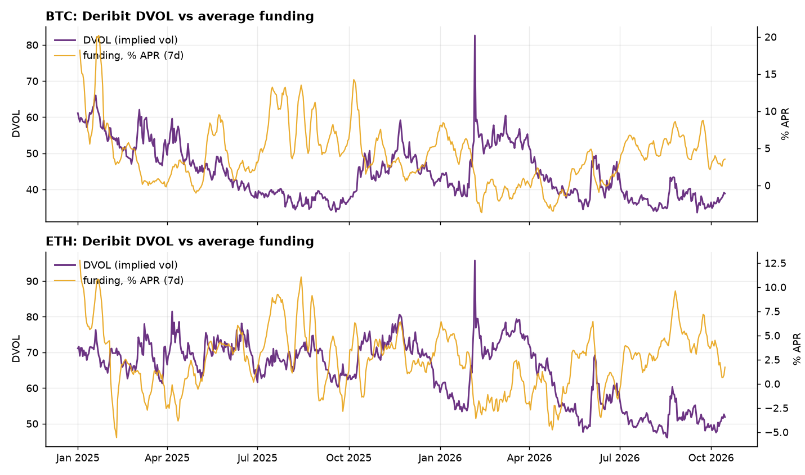
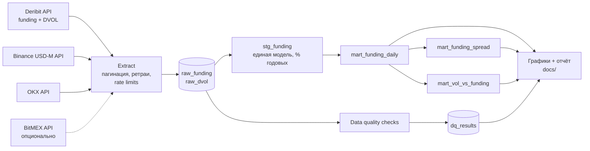

# Crypto Derivatives Pipeline

Инкрементальный ETL публичных данных по криптодеривативам с проверками качества данных: ставки фандинга бессрочных фьючерсов с трёх бирж и индекс подразумеваемой волатильности Deribit DVOL. Данные хранятся в DuckDB и проходят слои raw → staging → витрины на SQL.

Проект повторяет задачи, которые я решаю в работе аналитиком данных в криптофонде: сбор данных из API бирж, приведение к единой модели, контроль качества и витрины для аналитики. Все данные публичные, ключи API не нужны.

**Стек:** Python (pandas, requests), DuckDB, SQL, matplotlib, pytest

## Результаты



- Фандинг BTC с января 2025 по октябрь 2026 почти всё время положительный, в среднем от 0 до 10% годовых. Отрицательные периоды бывают редко, весной 2026 года — около −5%.
- Средний разрыв фандинга между биржами — около 4,3% годовых для BTC и 4,5% для ETH (максимум минус минимум за день). Чаще всего самый высокий фандинг на Binance, самый низкий на Deribit.
- Корреляция DVOL и фандинга слабая и отрицательная (−0,14 для BTC и ETH): всплески волатильности не означают роста фандинга.




## Архитектура



- **Extract** (`src/cdp/sources.py`). Отдельный экстрактор на каждую биржу, все приводятся к одной схеме: `exchange, symbol, asset, ts, funding_rate, interval_hours`. У каждой биржи своя пагинация: Deribit отдаёт данные окнами по 744 часа, Binance — страницами вперёд по времени, OKX — страницами назад через курсор `after`, DVOL — через курсор `continuation`.
- **HTTP-клиент** (`src/cdp/http.py`). Ограничение частоты запросов на стороне клиента, повторы с экспоненциальной задержкой, обработка `429` и заголовка `Retry-After`.
- **Load** (`src/cdp/storage.py`). Идемпотентный upsert по первичному ключу: повторный запуск не создаёт дублей. Загрузка инкрементальная: каждая серия догружается с последней загруженной метки времени.
- **Transform** (`sql/marts.sql`). Слои staging и витрины в виде SQL-представлений. Ставки с разной периодичностью (1, 4, 8 часов) приводятся к сопоставимым процентам годовых.

## Проверки качества данных

`src/cdp/quality.py` проверяет каждую серию (биржа × инструмент). Результаты сохраняются в таблицу `dq_results` и в отчёт [docs/data_quality.md](docs/data_quality.md).

| Проверка | Что ловит | Статус при срабатывании |
|---|---|---|
| duplicates | дубли по ключу (биржа, инструмент, время) | fail |
| gaps | пропуски интервалов с учётом периодичности конкретной биржи | warn |
| future_timestamps | метки времени из будущего (ошибки часовых поясов) | fail |
| outliers | значения выше жёсткого лимита (ошибка единиц) → fail; статистические выбросы по robust z-score (MAD) → warn | fail / warn |
| freshness | серия перестала обновляться | warn |

На текущих данных из 30 проверок 29 прошли. Одна нашла 4 экстремальных значения фандинга BTC на Deribit: все 20 января 2025, на пике рыночного ажиотажа. Это реальное событие на рынке, а не ошибка данных, поэтому статус warn, а не fail.

Для robust z-score установлен нижний порог разброса (MAD). Без него на Deribit, где ставка большую часть времени близка к нулю, проверка давала больше 400 ложных срабатываний.

## Как запустить

```bash
pip install -r requirements.txt

# Windows PowerShell: $env:PYTHONPATH="src"
export PYTHONPATH=src

python -m cdp all --since 2025-01-01   # загрузка, проверки, графики и отчёт
python -m cdp ingest                   # только догрузить новые данные
python -m cdp check                    # только проверки качества
python -m cdp all --exchanges deribit,binance

pytest                                 # юнит-тесты проверок качества
```

Первая загрузка за ~22 месяца занимает около минуты: ~36 тыс. строк фандинга и ~1,3 тыс. дневных свечей DVOL. Повторные запуски догружают только новые данные. Команда возвращает ненулевой код, если есть проверки со статусом fail, поэтому её можно ставить в планировщик или CI.

## Структура

```text
├── src/cdp/
│   ├── http.py        HTTP-клиент: ретраи, backoff, rate limit
│   ├── sources.py     экстракторы Deribit, Binance, OKX, BitMEX
│   ├── storage.py     DuckDB: схема, upsert, инкрементальные метки
│   ├── quality.py     проверки качества данных
│   ├── pipeline.py    оркестрация ingest → check
│   ├── report.py      графики и markdown-отчёт
│   └── __main__.py    CLI
├── sql/marts.sql      staging и витрины
├── tests/             pytest
└── docs/              графики и отчёт о качестве данных
```

## Ограничения

- OKX отдаёт через публичный API только последние ~3 месяца фандинга, поэтому серия OKX начинается с июля 2026. С каждым запуском история накапливается в базе.
- BitMEX блокирует запросы из некоторых регионов (HTTP 403), поэтому по умолчанию отключён. Включается флагом `--exchanges deribit,binance,okx,bitmex`.
- Deribit начисляет фандинг непрерывно и публикует почасовые значения 8-часовой ставки. Для сравнения с другими биржами они усредняются до дневных.
